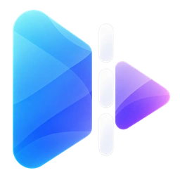

<p align="center">
  
</p>

<h1 align="center">Slice</h1>

<p align="center">
  A lightweight Windows video trimmer with a compact professional editing workspace and flexible export.
</p>

<p align="center">
  
  
  
  
</p>

## What is Slice?

Slice is intentionally focused. It gives you familiar timeline interactions and a professional panel-based workspace without layers, effects, accounts, cloud features, or full NLE complexity.

Open a video, split it into clips, trim clip edges, drag clips into a new order, remove clips, adjust volume, preview the sequence, and export.

## Features

- Native Windows video preview
- Drag and drop video opening
- Linked V1/A1 clip timeline with a compact panel-based workspace
- Dark and light interface themes (`Ctrl + Shift + L`)
- Split at the playhead
- Direct per-clip edge trimming
- Drag-and-drop clip reordering
- Selected clip deletion
- Preview follows the edited clip order
- Frame stepping
- Master volume control
- Undo support
- MP4, WebM, MKV, GIF, MP3, and WAV export
- Original, 1080p, 720p, and 480p resolution presets
- Original, 60, 30, 24, and 15 FPS presets
- Small, Balanced, and High quality presets
- Lossless stream copy when the edit allows it
- Lucide SVG interface icons
- No telemetry or sign-in

## Timeline controls

| Action | Control |
| --- | --- |
| Seek | Click a clip on the timeline |
| Split | Press `S` or use the scissors button |
| Trim | Drag the left or right edge of a clip |
| Reorder | Drag a clip left or right |
| Delete clip | Select a clip and press `Delete` |
| Undo | `Ctrl + Z` |
| Play / pause | `Space` |
| Previous / next frame | Playback toolbar buttons |
| Open video | `Ctrl + O` |

The timeline represents the final export order. Reordering clips changes both preview playback and export order.

## Tech stack

- C#
- .NET 10
- WinUI 3 / Windows App SDK
- Windows `MediaPlayerElement`
- FFmpeg and FFprobe for media processing

## Interface icons

Interface icons come from [Lucide](https://lucide.dev/) and are stored as SVG files. Slice does not use custom-drawn toolbar icons.

See [THIRD_PARTY_NOTICES.md](THIRD_PARTY_NOTICES.md) for the Lucide license notice.

## FFmpeg

Slice looks for `ffmpeg.exe` and `ffprobe.exe` in the following locations:

1. `Tools/` beside the application
2. The application directory
3. Your system `PATH`

The repository does not commit FFmpeg binaries.

## Build from source

Requirements:

- Windows 10 1809 or later, or Windows 11
- .NET 10 SDK

```powershell
./build.ps1
```

Or manually:

```powershell
dotnet restore
dotnet build -c Release -p:Platform=x64
```

## Portable build

```powershell
./publish.ps1
```

Output:

```text
artifacts/portable/Slice-win-x64/
artifacts/portable/Slice-win-x64.zip
```

## Installer build

The installer build uses Inno Setup 6.

```powershell
./build-release.ps1
```

Output:

```text
artifacts/installer/Slice-Setup-x64.exe
```

`build-release.ps1` also creates the portable ZIP.

## Project structure

```text
Slice/
├─ Assets/             App assets and Lucide SVG interface icons
├─ Controls/           Timeline control
├─ Dialogs/            Export UI
├─ Models/             Clip timeline and export models
├─ Services/           FFmpeg probing and export
├─ Tools/              Optional local FFmpeg binaries
├─ MainWindow.xaml     Main UI
└─ Slice.csproj
```

## Philosophy

Slice should stay focused on four things:

**Trim. Cut. Volume. Export.**

The goal is a fast single-track workflow, not a full multi-track nonlinear editor.

## License

Slice is released under the [MIT License](LICENSE).

FFmpeg and Lucide are separate projects and are distributed under their own licenses.
